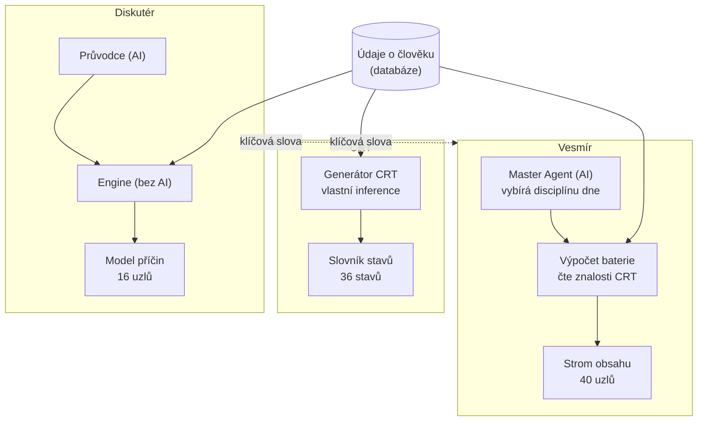
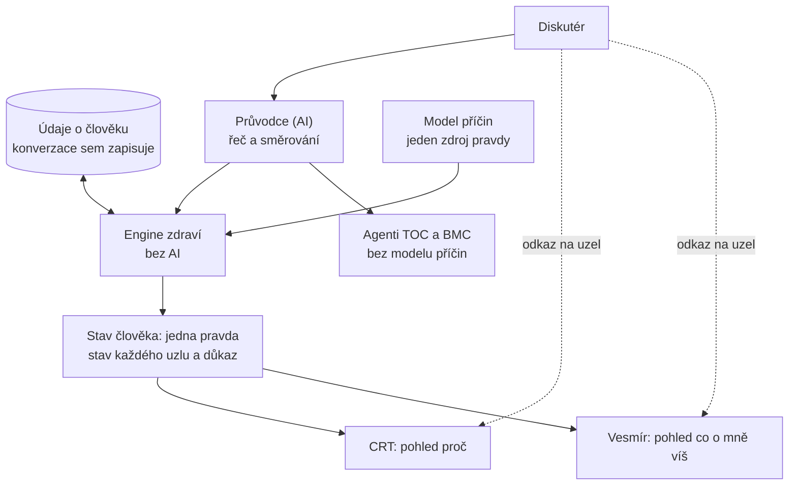

# Architektura CHJ: pracovní návrh (22. 10. 2026)

Stav: **návrh k potvrzení, bez změny kódu.** Zachycuje domluvu Josefa s Claudem z 20.–22. 10. 2026. Kanonické zůstávají `docs/CHJ-PRODUCT-ARCHITECTURE.md` a `docs/CHJ-ENGINE-ARCHITECTURE.md`; tento dokument je podklad k jejich případné aktualizaci.

## 1 Pracovní názvy
| Pojem | Co to je |
|---|---|
| **Chytré já (CHJ)** | celý produkt |
| **Diskutér** | pracovní název hlavní aplikace: konverzace (hlas, mobil, rychlá reakce). Jediná povinná aplikace. |
| **CRT** | pohled „proč": příčinná mapa osobního stavu. Pro uživatele možná „Mapa příčin" (nerozhodnuto). |
| **Vesmír** | pohled „co o mně víš a jak se mění": mapa a obsah (atlas). Zůstává. |
| **Průvodce** | dnes „AI orchestrátor": porozumění řeči, směrování do domén, lidská prezentace. Nerozhoduje. |
| **Engine** | deterministický rozhodovací postup (bez AI). |
| **Model příčin** | znalosti, se kterými engine pracuje (`data/engine/master.json` a související soubory). |
| **Balíček** | data a pravidla pro část modelu (Stabilita, Decathlon, …). |
| **Master Agent** | starý rozhodovač disciplíny dne (`api/orchestrator.js`). **Jiná věc než Průvodce.** Dnes ho volá Vesmír. |

Lehkost: **pozastaveno** (mimo longevity). TOC a BMC: samostatné vesmíry s AI agenty, bez modelu příčin. TOC je zároveň metoda uvnitř enginu (hledání constraintu).

## 2 Dnešní stav (ověřeno v kódu)

Nález: **tři oddělené modely** (engine 16 uzlů, CRT 36 stavů, Vesmír 40 uzlů obsahu), společných uzlů engine ↔ CRT je 10 (viz `docs/ID-REGISTRY-CHJ-CRT.md`). Vesmír má vlastního rozhodovače akcí (Master Agent), který nejde přes engine.

## 3 Cílový stav

Principy:
- **Diskutér CRT nepotřebuje.** Engine ani Průvodce CRT nečtou. CRT a Vesmír jsou volitelné pohledy, které jen čtou stav člověka.
- **Vesmír dnes na CRT závisí** (výpočet baterie čte soubory znalostí CRT). V cíli čte stav z enginu.
- Konverzace je jediná plocha, která **zapisuje** (údaj → důkaz → stav). CRT a Vesmír nesmějí přepsat rozhodnutí (stávající hranice z `CHJ-PRODUCT-ARCHITECTURE.md` §1).
- Nový vesmír nebo balíček nepřidává model, pokud nechybí významná kauzální cesta (principy 1–5 z `CLAUDE.md`).

## 4 Co je v enginu a co v modelu
- **Engine** (`api/engine/`): aktivace a inference stavů uzlů → projekce rizika → rozhodovací brána → páka a constraint → výběr akce s bezpečnostní bránou → denní rozhodnutí (ACT, ASK, HOLD, SAFETY). Bez AI, bez přirozené řeči.
- **Model** (`data/engine/`): 16 uzlů a 17 hran (typ vztahu, síla, kvalita důkazů), mapa intervencí, katalog akcí a instrukce, ekvivalenty akcí, cílové brány, potřeby údajů.
- Jednou větou: model je „co platí", engine je „co z toho plyne pro tohoto člověka teď".

## 5 Referenční případy Josef a Kovářová: kde jsou
Slouží jako **ověření vzorových kauzálních cest** (princip 2 z `CLAUDE.md`), ne jako samostatný produkt. Nejsou to testovací účty.
- **Josef:** skutečný účet v Supabase (uid chráněný v `CLAUDE.md`, nikdy do `TESTER_UIDS`); fixture `test/fixtures/josef.json`.
- **Kovářová:** fixture `test/fixtures/kovarova.json` a test `scripts/test-nba-kovarova.mjs` (podle hlavičky testu bez reálného účtu v DB; `CLAUDE.md` říká „viz Supabase", rozpor k ověření).
- **Uložené CRT:** `app/ukazka/crt-josef.html`, `app/ukazka/crt-kovarova.html`, `app/assets/examples/crt-kovarova.json` (veřejná ukázka, `/crt.html?vzor=kovarova`); zálohy CRT `data/crt/cache-backup/*.json`; původ popsán v `docs/CRT-EXAMPLE-PROVENANCE-2026-10-15.md`.
- **Zlaté stavy kódu:** git tagy `v0.2-crt-gold-*`, `v0.3-crt-gold-*`.
- Uložené ukázky jsou **starší snímky** (apex `THREATENED_HEALTHSPAN`, odstraněn ze slovníku stavů 9. 8. 2026; Kovářová bez `FALL_RISK`).

## 6 Otevřená rozhodnutí
1. Potvrdit cílové schéma a pracovní názvy (Diskutér, Průvodce, Mapa příčin).
2. Přejmenovat v kódu a dokumentaci „orchestrátor" na „Průvodce"? (zatím jen v diskusi)
3. Co s Master Agentem a akcemi v HUBu Vesmíru (jediný rozhodovač akcí má být engine).
4. CRT: přejít na stav z enginu (stínový běh, ochrana zlatých CRT).
5. Řazení podle závažnosti, hrana `FALL_RISK` → ztráta soběstačnosti a zdroje.
6. Sjednotit identifikátory (engine, CRT, Vesmír, asistenti: `longevity` vs. `dlouhovekost`).
